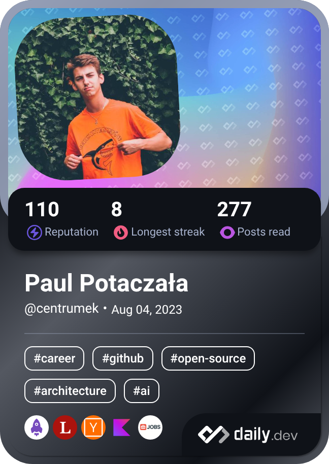

# Heeeeeello! 👋

----

    

<table>
  <tbody>
    <tr>
      <td align="center" width="70%" colspan="2">
        
        
        
      </td>
      <td width="30%" rowspan="2">
        
      </td>
    </tr>
  </tbody>
</table>

---

## Play with me on [Chess.com](https://www.chess.com/member/centrumek)

<!--START_SECTION:chessStats-->
<!-- Automatically generated with https://github.com/Balastrong/chess-stats-action -->

| Type | Rapid ⏲️ | Blitz ⚡ | Bullet 🔫 |
|:---:|:---:|:---:|:---:|
| Current | 1049 | 764 | 1369 |
| Best | 1132 | 1220 | 1369 |

| White ⚪ | Black ⚫ | Result 🏆 | Date 📅 | Position 🗺️ | Type 🕕 |
|:---:|:---:|:---:|:---:|:---:|:---:|
| ItsStevenn | **centrumek** | timeout ❌ | 16/10/2026 | <a href="http://www.ee.unb.ca/cgi-bin/tervo/fen.pl?select=8/KPk5/4p3/2P2p2/3PpPp1/4P1P1/8/8 b - - 2 43">Link</a> | Blitz |
| **centrumek** | VForMat | timeout ❌ | 16/10/2026 | <a href="http://www.ee.unb.ca/cgi-bin/tervo/fen.pl?select=n2r2k1/1p3ppp/pb6/8/5q2/4p3/2B1R2P/1K6 w - - 0 38">Link</a> | Blitz |
| **centrumek** | magnuswhoooooooo | checkmated ❌ | 7/10/2026 | <a href="http://www.ee.unb.ca/cgi-bin/tervo/fen.pl?select=5Q2/6pk/4p2B/pp6/8/P5PP/5P1K/3r3q w - - 1 34">Link</a> | Blitz |
| MrDiels | **centrumek** | timevsinsufficient ⏸️ | 7/10/2026 | <a href="http://www.ee.unb.ca/cgi-bin/tervo/fen.pl?select=2k5/q7/2K5/1N5p/6p1/8/8/6n1 b - - 0 45">Link</a> | Blitz |
| **centrumek** | Nomad017 | win 🥇 | 27/9/2026 | <a href="http://www.ee.unb.ca/cgi-bin/tervo/fen.pl?select=Q1k1r2r/2p2q2/2p5/7p/1P6/4P2p/1PP2PP1/R2R2K1 b - - 1 21">Link</a> | Blitz |

<!--END_SECTION:chessStats-->

## Learn languages with me on [Duolingo.com](https://www.duolingo.com/profile/Centrumek)

<!--START_SECTION:duolingoStats-->
<!-- Automatically generated with https://github.com/centrumek/duolingo-readme-stats-->

| Username | Day Streak | Total XP |
|:---:|:---:|:---:|
|  Centrumek |  1005 |  38055 |

| Language | XP |
|:---:|:---:|
|  Spanish |  16983 |
|  Ukrainian |  15683 |
|  Japanese |  5354 |

<!--END_SECTION:duolingoStats-->

<!--
**centrumek/centrumek** is a ✨ _special_ ✨ repository because its `README.md` (this file) appears on your GitHub profile.

Here are some ideas to get you started:

- 🔭 I’m currently working on ...
- 🌱 I’m currently learning ...
- 👯 I’m looking to collaborate on ...
- 🤔 I’m looking for help with ...
- 💬 Ask me about ...
- 📫 How to reach me: ...
- 😄 Pronouns: ...
- ⚡ Fun fact: ...
-->
